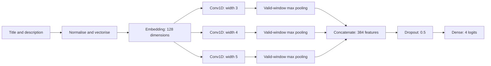

# Task 3: AG News implementation guide

The Task 3 section of `project_report.ipynb` trains a word-level TextCNN to
predict a news topic from its title and description. The saved notebook contains
the validation comparison, test predictions, figures and analysis.

## Run the reviewed notebook

Open the saved notebook to read the results. To reproduce them, start JupyterLab
from the project directory with one of the following commands.

| Mode | PowerShell | Ubuntu / WSL2 |
| --- | --- | --- |
| Train both input lengths and save the validation winner | `$env:TASK3_MODE = "train"; mise run lab` | `TASK3_MODE=train mise run lab` |
| Verify the selection and evaluate the official test set | `$env:TASK3_MODE = "final"; mise run lab` | `TASK3_MODE=final mise run lab` |

In a fresh kernel, run the cells from **Task 3 — AG News topic classification**
through **Read a few predictions**, in order. Task 3 has its own imports. The
first training run downloads the pinned dataset if needed. It uses TensorFlow
on CPU or GPU. A subsequent train run verifies and reuses completed checkpoints.
To change mode, stop the JupyterLab server and launch it with the new command.
The default `preview` mode skips the data and model runs. In PowerShell,
`Remove-Item Env:TASK3_MODE` clears the setting for future launches.

Back up the entire `artifacts/task3/valid-windows-v1/` directory to reproduce
the final evaluation on another computer. It contains the split, ordered
vocabulary, both checkpoints, histories, selection and cached predictions.
Final mode verifies the artifacts and reuses predictions for the same weights
and ordered test inputs. For a changed model or training protocol, use a new
experiment directory and identifier. The small synthetic model checks also run
in `mise run test` on Windows and Linux.

## 1. What the assessed work needs

Task 3 contributes **35%** of the project mark. The brief asks us to choose and
justify a text-analysis task and dataset, document preprocessing, implement and
evaluate one TensorFlow/Keras deep-learning model, and discuss its results and
limitations. Our proposed experiment compares two input lengths within that model.

| Required evidence | What to put in the notebook |
| --- | --- |
| Task and dataset justification | Explain four-topic news routing, the available labelled examples and why this is a manageable supervised task. |
| Dataset description | Original and retained counts, class mapping, source/version, duplicate audit and split procedure. |
| Preprocessing | Cleaning examples, tokenisation, training-only vocabulary, padding, truncation and unknown-word handling. |
| Model implementation | The actual Keras model code, shape/parameter summary and reasons for the main settings. |
| Training and evaluation | Saved history, validation comparison, locked checkpoint and final held-out metrics. |
| Analysis | Specific errors, measured limitations and improvements motivated by those observations. |

The preliminary audit below gives reference counts for checking a fresh run.
The notebook records the measurements from the reviewed experiment.

## 2. Dataset and environment

AG News has four balanced categories, **120,000 official training examples** and
**7,600 official test examples**. Each record contains a title, description and
label. The benchmark was assembled by Zhang, Zhao and LeCun from the larger AG
news collection. The short inputs and clear labels fit our training budget and
allow class-level error analysis. [TFDS catalogue](https://www.tensorflow.org/datasets/catalog/ag_news_subset),
[benchmark paper](https://arxiv.org/abs/1509.01626).

| TFDS integer | Topic | Original train | Original test |
| --- | --- | ---: | ---: |
| 0 | World | 30,000 | 1,900 |
| 1 | Sports | 30,000 | 1,900 |
| 2 | Business | 30,000 | 1,900 |
| 3 | Sci/Tech | 30,000 | 1,900 |

Update the shared environment after pulling the repository:

```powershell
mise exec -- python -m pip install -r requirements-dev.txt
mise exec -- python -c "import tensorflow_datasets as tfds; print(tfds.__version__)"
mise run lab
```

The repository pins `tensorflow-datasets==4.9.10` alongside TensorFlow/Keras.
`importlib-resources==7.1.0` supplies a resource lookup used by this TFDS version
on Python 3.12. A local download test exposed the missing dependency; CI checks
dataset construction and checksum metadata on Windows and Linux.

Use this loading pattern inside the notebook, with Jupyter started from the
project root:

```python
import tensorflow_datasets as tfds

datasets, info = tfds.load(
    "ag_news_subset:1.0.0",
    split=["train", "test"],
    as_supervised=False,
    with_info=True,
    shuffle_files=False,
    data_dir="data/downloads/tfds",
)
official_train, official_test = datasets
class_names = info.features["label"].names
```

Iterate with `tfds.as_numpy`, decode the two text fields as UTF-8, and combine
them as `title + " " + description`. Keep the integer label unchanged. TFDS's
`as_supervised=True` returns **description only**; its builder already converts
the original CSV labels 1–4 into 0–3.
[TFDS builder](https://github.com/tensorflow/datasets/blob/v4.9.10/tensorflow_datasets/datasets/ag_news_subset/ag_news_subset_dataset_builder.py).

Keep downloaded articles under ignored `data/downloads/`. Cite the dataset and
benchmark in the report. The dataset description states research/non-commercial
use; keep the public repository focused on code and report evidence.
[Dataset description](https://github.com/tensorflow/datasets/blob/v4.9.10/tensorflow_datasets/datasets/ag_news_subset/README.md).

Record the dataset version and archive SHA-256 in the data-audit output. The
verified `ag_news_csv.tar.gz` is 11,784,327 bytes with SHA-256:

```text
4e2fc37d369e6e317a8b62d0d2f11d379f8c3dde60c07c35a46b069a246498ad
```

TFDS checks this archive against its
[checksum record](https://github.com/tensorflow/datasets/blob/v4.9.10/tensorflow_datasets/datasets/ag_news_subset/checksums.tsv).

## 3. Cleaning and duplicate audit

Create a small typed `normalise_text(text: str) -> str` function. Apply the same
function to training, validation, final test inputs and later predictions:

1. Join the title and description with a space.
2. Repair bare numeric HTML entities with
   `re.sub(r"(?<!&)#(\d+);", r"&#\1;", text)`, then use `html.unescape`.
3. Apply `unicodedata.normalize("NFKC", text)` and lowercase.
4. Replace runs matched by `r"[\W_]+"` with one space, then strip the ends.

These rules preserve letters, numbers and stopwords. Splitting punctuation into
spaces keeps boundaries between adjacent words. Avoid stemming and stopword
removal in the initial configuration: the CNN learns from short sequences of
words. Document the loss of punctuation and case information as a trade-off.

For example, the **synthetic** string `Tech-firm reports #36;5 million &amp; growth`
becomes `tech firm reports 5 million growth`. Include a few actual development
examples in the notebook to explain the transformation. The preliminary audit
found bare numeric entities in 31,357 original training records.

Hash the complete normalised text with SHA-256 **before truncation or vocabulary
lookup**. This hash is the duplicate group. Apply the following fixed policy:

| Finding | Action before splitting development data |
| --- | --- |
| Empty normalised text | Exclude the development row and report the count. |
| Same text with different development labels | Exclude every development row in that conflicting group. |
| Development text also present in the official test set | Exclude the matching development rows; retain the official test set. |
| Same text and same label within development | Keep the rows together in one partition. |

Inspect test text hashes only for this overlap audit. Keep test labels and model
performance out of preprocessing choices and tuning. Leave all official test
rows in the final evaluation and report its own duplicate/conflict counts when
describing that evaluation. Exact hashing covers equality after our cleaning;
similar articles with different wording can remain.

**Preliminary audit, 18 November 2026**, using the rules above and the pinned
environment:

| Item | Observed count |
| --- | ---: |
| Original development rows | 120,000 |
| Distinct normalised development texts | 119,710 |
| Empty development texts | 0 |
| Development rows overlapping official test text | 28 |
| Conflicting-label development groups | 37 |
| Rows in those conflicting groups | 75 |
| Total excluded development rows, counting the union | 103 |
| Retained development rows | 119,897 |

Compute these counts from the data. If they change, inspect the dataset version,
cleaning rules and checksum before training; keep an explanation of the change.

## 4. Freeze the training/validation split

Use `StratifiedGroupKFold(n_splits=5, shuffle=True, random_state=42)` on the
retained development rows, with label as `y` and normalised-text hash as `groups`.
Take **the first fold only**, giving approximately 80% training and 20%
validation. Save its membership and reuse it for every experiment. This combines
class balance with keeping duplicate texts in one partition.
[scikit-learn API](https://scikit-learn.org/stable/modules/generated/sklearn.model_selection.StratifiedGroupKFold.html).

Give each row an ID from its position in the unshuffled TFDS split, for example
`train_000000`. These are TFDS iteration positions. Save the ID, text hash,
label, split and exclusion reason as applicable; matching the ID/hash pairs on
reload confirms the same data order. Keep source text out of this split manifest.

The preliminary split produced:

| Partition | World | Sports | Business | Sci/Tech | Total |
| --- | ---: | ---: | ---: | ---: | ---: |
| Fit training | 23,988 | 23,994 | 23,968 | 23,968 | 95,918 |
| Validation | 5,996 | 5,999 | 5,992 | 5,992 | 23,979 |

Before fitting, assert that row IDs are unique, class IDs are 0–3, all classes
are represented, training/validation hashes are disjoint, and retained
development hashes have no intersection with test hashes. Record the actual
counts. Use this fixed split for development; the model sees only the fit partition.

## 5. Vocabulary and sequence length

Fit a `TextVectorization` vocabulary on **fit-training text only**. Use
`max_tokens=20_000`, `standardize=None`, `split="whitespace"` and
`output_mode="int"`; cleaning already happens in the Python helper. Use
`output_sequence_length=64` or `128` for the controlled comparison.

Reuse the same learned vocabulary in both configurations. Save its order.
Integer 0 is padding and 1 represents an unknown token; the vocabulary limit
includes these reserved entries. Set the embedding's `input_dim` from
`vectorizer.vocabulary_size()`.
[TextVectorization API](https://keras.io/api/layers/preprocessing_layers/text/text_vectorization/).

Use whitespace token counts **before padding** to justify the length choice.
The preliminary fit partition had these statistics:

| Measure | Observed value |
| --- | ---: |
| Median length | 38 tokens |
| 95th percentile | 56 tokens |
| 99th percentile | 76 tokens |
| Maximum | 181 tokens |
| Longer than 64 | 2,595 / 95,918, about 2.71% |
| Longer than 128 | 89 / 95,918, about 0.093% |

Thus 64 tokens offers a compact input, while 128 preserves more long examples.
Measure the validation trade-off. Right-pad shorter inputs and keep the first
`L` tokens of longer inputs, placing the title first through the join order.

Report the vocabulary size, training/validation truncation fractions and
validation OOV fraction: count token IDs equal to 1 divided by all nonzero token
IDs in the chosen input representation. State that this OOV measure is taken
after truncation. Keep the vocabulary fixed when evaluating new text.

## 6. One TextCNN architecture

Use a single-channel word CNN inspired by Kim's sentence classifier: embeddings,
parallel local phrase detectors, max pooling and dropout. Kim explored both
random and pretrained word embeddings. Our smaller randomly initialised
embeddings keep the initial experiment self-contained; train them with the
classifier. [Kim, 2014](https://aclanthology.org/D14-1181/).



| Component | Initial setting and reason |
| --- | --- |
| Integer input | Fixed length 64 or 128, one sequence per article. |
| Embedding | 128 dimensions; learned semantic features with a modest parameter budget. |
| Three parallel Conv1D branches | Widths 3, 4, 5; 128 filters each, ReLU, stride 1, `padding="valid"`. Capture short phrases of several lengths. |
| Pooling per branch | Maximum over valid all-word windows; retain a phrase response wherever it occurs. |
| Concatenation | 384 pooled features. |
| Dropout | 0.5 before the classifier to regularise the pooled representation. |
| Output | `Dense(4, dtype="float32")`, returning logits. |
| Loss and metric | `SparseCategoricalCrossentropy(from_logits=True)` and `SparseCategoricalAccuracy`. |

This has **2,758,532 parameters** when the vocabulary has exactly 20,000 entries.
Confirm the actual count with `model.summary()`. Use softmax only when displaying
class probabilities; `argmax` of the logits gives the predicted class.

### Padding needs an explicit pooling rule

`Embedding(mask_zero=True)` generates a mask, while the pinned Conv1D and
GlobalMaxPooling1D layers do not consume it automatically. Use
`Embedding(mask_zero=False)` and pass the integer tokens to a small pooling
helper so that padded positions have an explicit treatment.
[Embedding API](https://keras.io/api/layers/core_layers/embedding/),
[GlobalMaxPooling1D API](https://keras.io/api/layers/pooling_layers/global_max_pooling1d/).

For a right-padded sequence with `n` nonzero tokens and convolution width `k`,
there are `max(n - k + 1, 0)` valid windows. Keep those leading convolution
positions and replace the rest with zero **after ReLU**, then take the maximum.
ReLU makes zero a safe value for excluded windows. A sequence shorter than `k`
gets a zero feature vector from that branch. This rule requires right padding
and nonnegative convolution outputs.

Implement that rule in one small registered Keras layer, with `kernel_size` in
`get_config()`. TensorFlow operations belong inside its `call` method. Keep this
helper in the assessed notebook, alongside the model builder. The development audit excludes articles that are empty after cleaning.

Verify that adding extra right padding to the same tokens leaves pooled features
unchanged, that short inputs remain finite, and that saving/reloading preserves
predictions. A synthetic local probe passed these checks and a finite-gradient
check with the pinned environment. Repeat them for the teammate's implementation.
[Keras custom-object saving](https://keras.io/guides/serialization_and_saving/).

## 7. Training and the bounded experiment

Start with Adam at `1e-3`, batch size 128 and at most 10 epochs. Use
`EarlyStopping(monitor="val_loss", patience=2, restore_best_weights=True)` and
save the minimum-validation-loss checkpoint with
`ModelCheckpoint(".../best.keras", monitor="val_loss", mode="min", save_best_only=True)`.
Use a separate existing output directory for each run, then reload that
checkpoint for its reported metrics.
[EarlyStopping](https://keras.io/api/callbacks/early_stopping/),
[ModelCheckpoint](https://keras.io/api/callbacks/model_checkpoint/).

Keep the model in float32 initially. Use `keras.utils.set_random_seed(42)` before
constructing each fresh model; record the device and software versions. For
repeat runs, clear Keras state before setting the next seed. Where reproducible
GPU operation is required, enable TensorFlow deterministic operations and record
its runtime effect. [TensorFlow determinism](https://www.tensorflow.org/api_docs/python/tf/config/experimental/enable_op_determinism).

Construct `tf.data` batches from the prepared text/tokens and labels. Shuffle
only training examples, with a recorded seed and reshuffling each epoch. Keep
validation and test order fixed so predictions align with labels. Vectorise
in batches, then prefetch. If caching, cache deterministic tokenised records
before shuffling. Avoid retaining unnecessary copies of the raw data.

Work through these checks before the full experiment:

1. Print a few development examples with integer and topic labels; inspect
   normalisation and token IDs.
2. Check a batch has input shape `(batch, L)`, labels `(batch,)` and logits
   `(batch, 4)`, with finite loss and gradients.
3. Run a short training smoke check on a class-balanced development subset.
   Treat its output as debugging evidence.
4. Run the full fit partition with validation and checkpointing on the Legion
   or the agreed GPU runtime. Record elapsed training time.

Use the following comparison; keep the split, vocabulary, optimiser, embedding,
filters, dropout, seed and maximum epochs fixed:

| Run | Sequence length | Seed | Purpose |
| --- | ---: | ---: | --- |
| `textcnn-l64-s42` | 64 | 42 | Compact-input configuration |
| `textcnn-l128-s42` | 128 | 42 | Measure the effect of retaining longer text |

Compare **validation accuracy**, then macro-F1 for an exact tie, then prefer 64
tokens if both tie. Record loss, best epoch, parameters and runtime as context.
These two runs form the core experiment. If time permits, repeat the selected
length with seeds 43 and 44 to report validation mean and standard deviation;
keep the seed-42 checkpoint for final testing. Record this extra stability check
as such, keeping all runs in the results table.

Use validation errors to explain observed behaviour. If a clear implementation
problem appears, fix it and rerun the affected comparison consistently. Discuss
additional tuning with PenSul before expanding the experiment budget. The brief
asks for one deep-learning model; a well-explained controlled experiment keeps
the report focused.

## 8. Final evaluation and analysis

Review the validation table with PenSul, then record the selected configuration,
vocabulary, split identity and checkpoint hash. Run **one final evaluation** of
that locked checkpoint on all 7,600 official test examples. Obtain predictions
once and derive the metrics/plots from them. Keep the selected model fixed while
writing the test analysis.

Include:

- Accuracy and macro-F1, plus per-class precision, recall, F1 and support.
- A labelled confusion matrix, with counts and optionally row-normalised values.
- Training/validation loss and accuracy curves, showing the selected epoch.
- A compact experiment table covering both input lengths and any stability runs.
- A reproducible sample of correct and incorrect predictions, with true/predicted
  topic, a short relevant excerpt and an explanation of likely failure causes.

Use validation examples during development. After final testing, analyse test
errors descriptively. A useful sampling rule is the first three errors by saved
row ID from each of the two most common confusion pairs; report if fewer exist.
Inspect whether truncated text, unknown names, shared topic vocabulary or genuinely
mixed-topic articles explain those particular cases. Label these explanations
as interpretations of the examples.

As context, a constant classifier has 25% accuracy on the balanced official test
set. Explain the measured gain over this reference using our own results.
Softmax scores provide relative class scores; high scores alone do not establish
well-calibrated confidence.

Discuss the limitations supported by the experiment: historical English news,
only four categories, discarded punctuation/case, vocabulary limits, truncation,
the CNN's local phrase windows, and remaining near-duplicate articles. Link each
proposed improvement to an observed issue. For example, frequent unknown names
could motivate subword tokenisation; errors requiring distant context could
motivate a contextual encoder in future work. Keep proposed work separate from
completed experiments.

## 9. Functions, artifacts and handoff

Keep the implementation in clear notebook sections. Useful function boundaries
are loading records, normalising text, auditing/splitting, building the vectoriser,
building the CNN, training one run and evaluating predictions. Type ordinary
Python helpers; use concise docstrings for the audit and padding logic.

| Artifact | Suggested location | Git treatment |
| --- | --- | --- |
| Downloaded news data | `data/downloads/tfds/` | Ignored |
| Checkpoints, full vocabulary and split records | `artifacts/task3/<run_id>/` | Ignored; preserve a shared copy for the team |
| Histories and run metadata for both lengths | `artifacts/task3/valid-windows-v1/l{64,128}-s42/` | Back up with the checkpoints |
| Audit, validation table, final metrics and figures | Task 3 cell outputs in `project_report.ipynb` | Tracked |
| Code, explanations and selected outputs | `project_report.ipynb` | Track |

Save the normalisation configuration, ordered vocabulary, class order, sequence
length, split membership, random seed, environment and checkpoint SHA-256 with
each run. Retain the trained `.keras` model. Loading a custom layer requires
executing its registered class definition first; the file stores configuration
and weights. Reconstruct the vectoriser from its saved vocabulary and configuration,
apply the same normaliser, and confirm matching predictions on a fixed batch.

Keep the shared checkpoint bundle outside Git and record where the team can
retrieve it. Before handing over, verify that another member can load the bundle
and produce the same predictions. Preserve required figures and outputs in the
submission notebook so it can be read without downloading model files.

For subsequent changes, start a branch from the current `main`, make a pull
request and ask the owner to review changes before merging. Include validation
evidence for any change to the model or preprocessing. Keep the test set for the
selected model. See the [development workflow](development-workflow.md).
